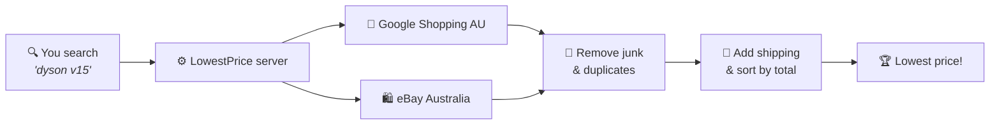

<div align="center">

# 🏷️ LowestPrice

### Find the cheapest place to buy anything in Australia, shipping included.

Type in what you want. LowestPrice checks Australian stores at once, skips the junk listings and shows you the best deal.


[Features](#-features) • [Quick start](#-quick-start) • [Real prices](#-turn-on-real-prices) • [How it works](#-how-it-works) • [Troubleshooting](#-troubleshooting)

</div>

---

## ✨ Features

| | |
|---|---|
| 🛒 **Many stores in one search** | JB Hi-Fi, Harvey Norman, Officeworks, Amazon AU, Big W, Kogan, eBay and more |
| 🚚 **True total price** | Ranked by price **plus shipping**, so cheap listings with expensive postage don't win |
| 🧹 **No junk results** | Cases, chargers, spare parts and suspiciously cheap listings are hidden automatically |
| 🏷️ **Condition filter** | Choose new, used or refurbished |
| 🖼️ **Real product photos** | Pulled straight from each listing |
| 📍 **Local to you** | Only items sold in, and shipping within, Australia |
| 🛡️ **Keeps working** | If one store is down, you still get results from the others |
| 🎮 **Demo mode** | Try it immediately, with no sign-ups or keys needed |

---

## 🚀 Quick start

You'll need **[Node.js](https://nodejs.org) 18.18 or newer**.

**1. Download and install**

```bash
git clone <your-repo-url> lowestPrice
cd lowestPrice
npm install
```

**2. Create your settings file**

```bash
cp .env.example .env.local
```

**3. Start the app**

```bash
npm run dev
```

**4. Open it:** go to **http://localhost:3000** and search for something 🎉

> [!NOTE]
> Without API keys the app runs in **demo mode** and shows made-up prices. Follow the next section to get real listings.

---

## 🔑 Turn on real prices

You only need **one** of these, but adding both gives you the most results.

### Option A: Google Shopping (recommended)

Covers the most Australian stores. **Free for 100 searches a month.**

1. Sign up at **[serpapi.com](https://serpapi.com)**.
2. Copy your key from **[your API key page](https://serpapi.com/manage-api-key)**.
3. Paste it into `.env.local`:
   ```env
   SERPAPI_KEY=paste_your_key_here
   ```

### Option B: eBay Australia

**Free.** Adds Buy-It-Now listings from Australian sellers.

1. Sign up at **[developer.ebay.com](https://developer.ebay.com)**.
2. Create a **production** keyset.
3. Paste both values into `.env.local`:
   ```env
   EBAY_CLIENT_ID=your_client_id
   EBAY_CLIENT_SECRET=your_client_secret
   ```

### 📍 Optional: set your location

Gives you more local results and more accurate shipping costs:

```env
SEARCH_LOCATION=Melbourne, Victoria, Australia
POSTCODE=3000
```

### ✅ Check it worked

Restart the app (press **Ctrl+C**, then run `npm run dev` again) and run a search. The badges above the results show which sources are working:

| Badge | Meaning |
|---|---|
| 🟢 `Google Shopping: 40 results` | Working |
| ⚪ `eBay: off` | No key set, so the source is skipped |
| 🔴 `eBay: error` | Something went wrong. Hover over the badge to see why |

> [!TIP]
> Repeating the same search within 10 minutes reuses the saved results, so it doesn't use up your free searches.

> [!WARNING]
> Keep your keys secret. `.env.local` is already excluded from git, so never paste keys into `.env.example` or anywhere else that gets committed.

---

## 🧠 How it works



In plain English:

1. **You search.** Your browser sends the search to the LowestPrice server. Your API keys stay on the server and are never sent to the browser.
2. **It asks every store at the same time.** Results arrive in seconds. Any store that takes longer than 8 seconds is skipped.
3. **It throws out the junk:**
   - listings that don't match what you typed
   - accessories like cases and chargers, unless you searched for one
   - prices that are too good to be true (less than 40% of the typical price)
4. **It sorts by total cost** (price + shipping) and shows the cheapest offer at the top.

<details>
<summary><b>🔧 Technical details: what each file does</b></summary>

<br/>

**`app/page.tsx`: the search page**
A React client component. It sends your search to `/api/search` and shows the results: the "Lowest price" card, the list of other offers and the source badges.

**`app/api/search/route.ts`: the API endpoint**
Checks the input (2–200 characters, and a valid condition) and returns the results as JSON.

**`lib/search.ts`: the core logic**
1. **Cache:** results are kept in memory for 10 minutes per search.
2. **Fan out:** every configured source runs in parallel with `Promise.all`, with an 8-second timeout each. Each source has its own `try/catch`, so one failure never breaks a search.
3. **Filter:** removes duplicates, applies the condition filter, then checks title matches, drops accessories and drops price outliers.
4. **Sort:** orders offers by `total`. The first offer becomes `lowest`.

**`lib/providers/`: one file per price source**
Every source implements the same interface and returns offers in the same shape:

```ts
interface Provider {
  name: string;
  isConfigured(): boolean;                                  // are the API keys set?
  search(query: string, signal: AbortSignal): Promise<Offer[]>;
}
```

| File | What it does |
|---|---|
| `serpapi.ts` | Searches Google Shopping on google.com.au and reads shipping from text like "Free delivery" |
| `ebay.ts` | Gets an OAuth token (cached), searches eBay AU for Buy-It-Now items located in Australia, and requests 500px photos |
| `demo.ts` | Generates fake but consistent offers, plus one fake accessory listing to show the filter working |
| `util.ts` | Turns price text into numbers, standardises the condition and calculates totals |

**`app/ProductImage.tsx` + `next.config.ts`: images**
Photos load through the Next.js image optimizer, which fetches, resizes and caches them on the server. That avoids sites that block their images from loading elsewhere. Only approved image hosts are allowed, and a placeholder shows if an image fails.

**`lib/region.ts`: market settings**
Country, currency, locale, Google domain and eBay marketplace.

</details>

<details>
<summary><b>📡 API reference</b></summary>

<br/>

```
GET /api/search?q=<item>&condition=any|new|used|refurbished&strict=true|false
```

| Parameter | Default | Description |
|---|---|---|
| `q` | (required) | What to search for, 2–200 characters |
| `condition` | `any` | Only return offers in this condition |
| `strict` | `true` | Hide accessories and unlikely matches |

Example response (shortened, illustrative values):

```json
{
  "query": "dyson v15",
  "lowest": { "store": "JB Hi-Fi", "price": 899, "shipping": 0, "total": 899, "currency": "AUD" },
  "offers": ["..."],
  "providers": [{ "name": "Google Shopping", "status": "ok", "count": 40 }],
  "filteredOut": 6,
  "cached": false
}
```

</details>

<details>
<summary><b>📁 Project structure</b></summary>

<br/>

```
app/
├── api/search/route.ts   API endpoint
├── page.tsx              Search page
├── ProductImage.tsx      Image with optimizer and fallback
├── layout.tsx            Root layout
└── globals.css           Styles (light and dark mode)
lib/
├── search.ts             Filtering, ranking and caching
├── region.ts             Market settings (Australia)
├── types.ts              Shared types
└── providers/            One file per price source
next.config.ts            Allowed image hosts
.env.example              Template for .env.local
```

</details>

---

## 🎨 Customising

| I want to… | Edit this |
|---|---|
| ➕ Add another store | Create a provider in `lib/providers/` and add it to `PROVIDERS` in `lib/search.ts`. If it uses a new image host, add the host to `next.config.ts` and `app/ProductImage.tsx` |
| 🧹 Change what counts as an accessory | `ACCESSORY_WORDS` in `lib/search.ts` |
| ⏱️ Change how long results are cached | `CACHE_TTL_MS` in `lib/search.ts` |
| ⌛ Change the store timeout | `PROVIDER_TIMEOUT_MS` in `lib/search.ts` |
| 🌏 Use a different country | `lib/region.ts` |
| 💅 Change the look | `app/globals.css` |

### Commands

| Command | What it does |
|---|---|
| `npm run dev` | Start the app for development |
| `npm run build` | Build for production |
| `npm start` | Run the production build |
| `npm run typecheck` | Check the code for type errors |

---

## 🩺 Troubleshooting

<details>
<summary><b>❌ <code>ENOENT: no such file or directory ... .next/server/app/page.js</code></b></summary>

<br/>

Two copies of the app are probably running at once and overwriting each other's files. To fix it:

```bash
pkill -f "next dev"   # stop every running copy
rm -rf .next          # clear the build folder (it's rebuilt automatically)
npm run dev           # start a single copy
```

</details>

<details>
<summary><b>🎮 I only see demo results</b></summary>

<br/>

The app isn't finding your keys. Check that:
- they're in **`.env.local`**, not `.env.example`
- there are no spaces or quotes around the values
- you **restarted** `npm run dev` after saving the file

</details>

<details>
<summary><b>🔴 A source badge is red</b></summary>

<br/>

Hover over the badge to see the error:
- **"Invalid API key"**: copy the key again from the provider's website.
- **A timeout**: the store took longer than 8 seconds to respond. Try again.

</details>

<details>
<summary><b>🔌 "Port 3000 is in use"</b></summary>

<br/>

Another copy of the app is already running. Press **Ctrl+C** in its terminal, or run `pkill -f "next dev"`.

</details>

---

## 📝 Good to know

- 💡 Prices come from third-party APIs and can lag behind the store's own website. **Always check the final price before you buy.**
- 🗄️ Saved results are cleared whenever the server restarts. For a production deployment with several servers, use a shared cache such as Redis.

<div align="center">

<br/>

Made with ☕ in Australia 🇦🇺

</div>
